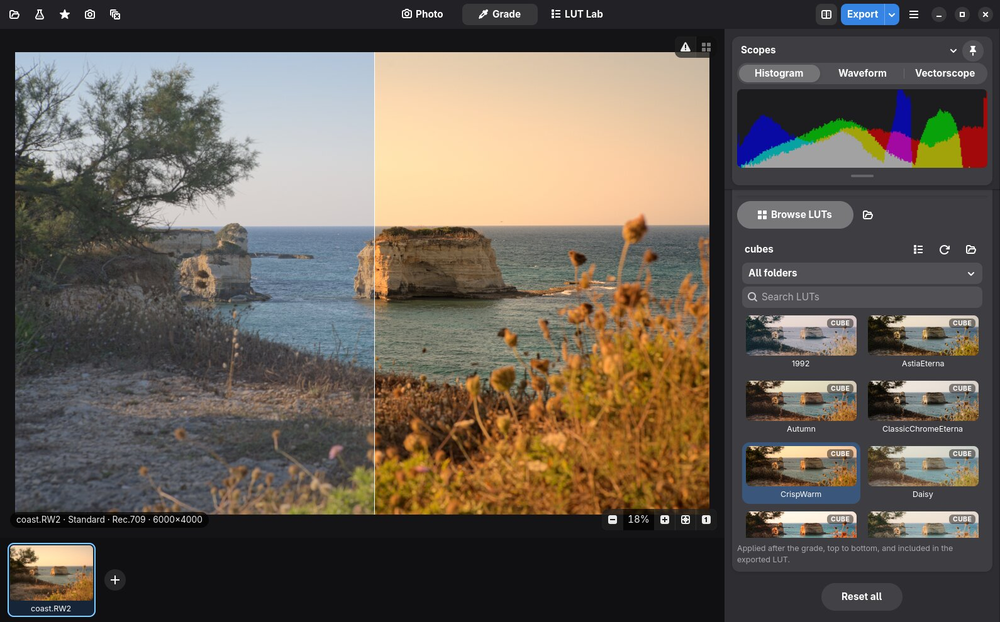
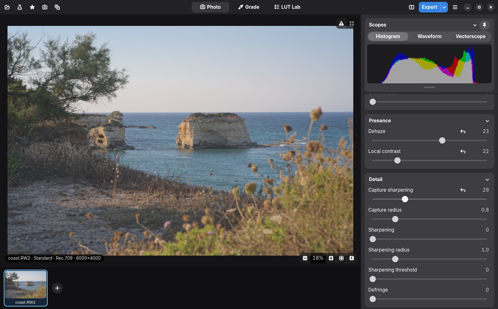
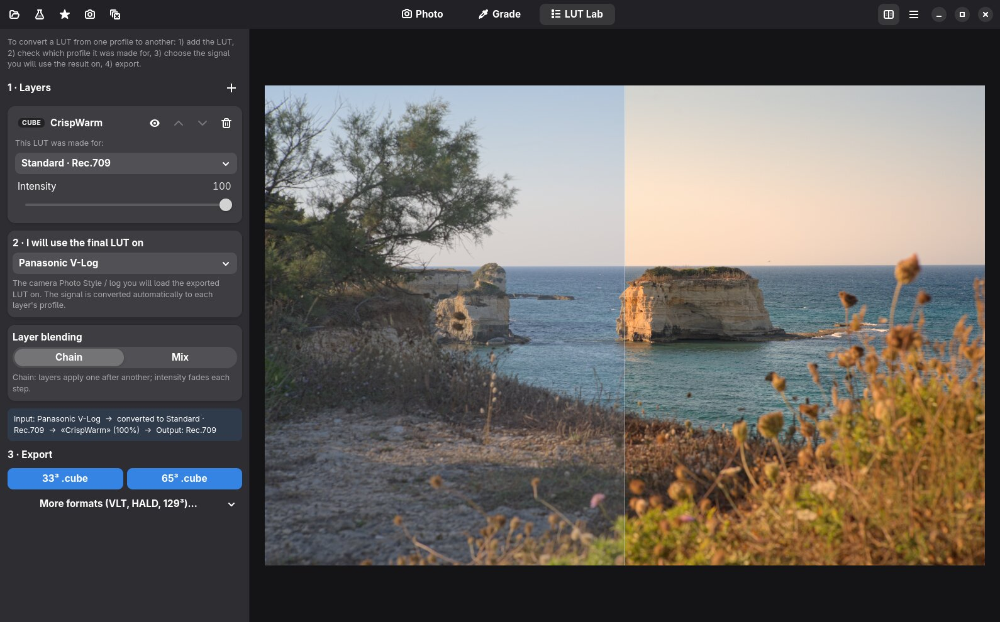

<div align="center">


# RawVibes

### Develop your RAW photos and take the look back to the camera.

RawVibes is a free, open-source RAW photo editor for Linux with a colorist's
color grading tools built in. Develop a Lumix S9 RW2 (or any RAW that rawler reads)
on the GPU, grade it with wheels, curves and your LUT library, and export the photo
at full resolution. Then export the same grade as a 3D LUT, `.cube` or `.vlt`,
that your camera loads as a Real Time LUT.

[](LICENSE)




</div>

---

## Why RawVibes?

RawVibes started as VibingLUT, a workbench for building and converting 3D LUTs.
Its author shoots a Lumix S9 and wanted one app that goes from the RW2 to the
finished photo, and from the look built on that photo to a LUT loaded into the
camera. RawVibes adds a full RAW development stage in front of the grade.

If you develop with darktable or RawTherapee, RawVibes is an alternative built
around one idea: the look you grade on a photo is also a LUT you can take with you.

- **One photo, two outputs.** The Photo tab holds what only a still can have:
  noise reduction, sharpening, crop, vignetting. The Grade tab holds what a LUT can
  carry: tone, colour, curves, LUTs. Export the photo with both, or export the
  Grade alone as a LUT. The panel labels each side, so you know what reaches the
  camera.
- **Published algorithms.** RCD demosaicing, inpaint-opposed highlight
  reconstruction, Richardson–Lucy capture sharpening and the RawNIND neural
  denoiser: ports of the methods darktable and RawTherapee ship.
- **On the GPU from the first pixel.** The RAW load, demosaic, development, grade and
  AI denoise run on the GPU through wgpu (Vulkan on Linux, Metal on macOS).
  Sliders draw a fast draft while you drag and the full-quality frame when you stop.
- **Your files stay as they are.** Edits live in a small sidecar next to the photo
  (`photo.RW2.rawvibes.json`) and come back when you reopen it.

---

## Features

### Photo: develop the RAW



- **White balance** as shot, from presets (daylight, cloudy, shade, tungsten,
  fluorescent, flash), from a grey you pick on the photo, or by temperature and tint.
- **Exposure** with **inpaint-opposed highlight reconstruction**, so clipped skies
  keep their colour.
- **RCD demosaicing** for Bayer sensors; X-Trans goes through rawler's Markesteijn
  path.
- **Noise reduction, classic or AI.** Classic: non-local means on luminance and
  wavelets on chrominance. AI: the RawNIND UtNet2 network (the weights darktable
  ships), running on the GPU in our own WGSL shaders. A 24 MP RW2 takes about
  2 seconds on an RTX 4070 Ti SUPER.
- **Presence:** dehaze (negative values add haze) and local contrast.
- **Detail:** Richardson–Lucy capture sharpening, output sharpening with radius
  and threshold, and defringe.
- **Lens:** chromatic aberration correction for red/cyan fringes, and vignetting
  correction set by hand.
- **Crop** with ratio presets (1:1, 5:4, 4:3, 3:2, 16:9, 21:9, 2.39:1, XPan 65:24,
  6:17 and their portrait versions) and **straighten** by angle or by dragging
  along the horizon.
- **As in camera:** one click sets white balance and exposure as shot. A
  preference applies it to every RAW you open for the first time.

### Grade: build the look

- **Warmth and tone:** temperature and tint with CAT16 adaptation; exposure,
  contrast, highlights, shadows, whites and blacks in log space.
- **Colour:** saturation, vibrance, shadow and highlight saturation in OKLab /
  OKLCh, film-style subtractive saturation, and a channel mixer with a black &
  white mode.
- **Primary colour wheels:** lift, gamma, gain and offset, each with a luma control.
- **Selective colour** for eight hue bands, and **hue curves** (hue vs hue, hue vs
  saturation, luminance vs saturation).
- **Curves:** master and R/G/B, monotone (Fritsch–Carlson) so they never overshoot.
- **Soft light** and a **creative vignette** with amount, midpoint, roundness and
  feather.
- **Reference match:** pick a photo whose colour you like and RawVibes fits the
  grade to it. On a RAW, *Camera JPEG* fits the grade to the JPEG the camera
  embedded, so you can start from the camera's own rendering.
- **LUTs on the photo.** Press `B` and every LUT in your folder is rendered on the
  photo you are editing. Click one to preview it full size, then stack as many as
  you want after the grade, each with its own intensity.
- **Presets** save the whole grade; VibingLUT presets import as they are.

Each section has an eye toggle to bypass it, and `\` splits the photo into before
and after.

### Check your work

- **Scopes:** histogram, waveform and vectorscope with a skin tone line (`K`). Pin
  them so they stay in view while you scroll the panel.
- **Clipping overlay** (`C`) for crushed blacks, clipped highlights and colours out
  of gamut.
- **Zoom** to fit or to 100 % (`Ctrl+1`), and pan by dragging.
- **Filmstrip** to move between photos, and a grid of all of them (`G`).
- **Test chart** (`T`): grey ramps, a full hue sweep and the 24 ColorChecker
  patches, so a LUT that tints neutrals or bends skin tones shows at once.


### Export the photo


`Ctrl+E` exports the full resolution of the crop with every edit, in sRGB:

| Format | For |
|---|---|
| JPEG, 8-bit | Sharing. The dialog shows the expected file size as you change the quality, and remembers the quality. |
| PNG, 16-bit | Lossless archive. |
| TIFF, 16-bit | Print, or more editing in another app. |

The file is written to a temporary copy first, so stopping an export leaves the
old file untouched.

### LUT Lab: combine LUTs and convert them between log profiles



- **Chain** LUTs one after another, or **mix** them as a weighted average in OKLab,
  each with its own intensity.
- **Retarget a LUT to another camera profile.** Tell the Lab which profile a LUT
  was made for and which signal you will load it on. The conversion uses the
  manufacturers' log curves and gamut matrices. Use Fujifilm's F-Log2 C film
  simulation LUTs on a Panasonic in V-Log, turn a V-Log to Rec.709 LUT into one
  for S-Log3 or C-Log3, and back.
- The source profile is detected from vendor file names such as
  `FLog2C_to_ETERNA…`, and a plain-language line says what the exported LUT will do.

### Export LUTs

This is how you create a LUT from a photo: grade it, then press `Ctrl+Shift+E` to
export the Grade tab, LUTs included, as a 33³ `.cube`. The export menu has the
other sizes and formats:

| Target | Format | Size |
|---|---|---|
| Cameras, monitors, recorders, OBS | `.cube` | 33³ |
| Grading and editing (Resolve, Premiere, Final Cut, Nuke…) | `.cube` | 65³ |
| Maximum precision | `.cube` | 129³ |
| Panasonic VariCam / Lumix (native format) | `.vlt` | 17³ |
| Photo editors, GIMP, ImageMagick, ffmpeg `haldclut` | HALD CLUT `.png` (16-bit) | 64³ |
| Identity HALD for external tools | HALD `.png` | 64³ |

The LUT holds only what a LUT can reproduce. Noise reduction, sharpening, crop and
vignetting stay in the Photo tab, so the look on the camera matches the look in
the app.

---

## Supported cameras and profiles

**RAW in:** every format [rawler](https://crates.io/crates/rawler) decodes: Panasonic
RW2 and RAW, Canon CR3, CR2 and CRW, Nikon NEF and NRW, Sony ARW, SR2 and SRF,
Fujifilm RAF (X-Trans too), Olympus / OM System ORF, Pentax PEF, Samsung SRW, Leica
RWL, Hasselblad 3FR and FFF, Phase One IIQ, Sigma X3F, Kodak, Minolta, Mamiya, Leaf,
Epson and ARRI files, and DNG from any camera or phone. Monochrome sensors open too.
The Lumix S9 is tuned and tested first. JPEG, PNG, TIFF and WebP open with the
Grade, LUT and crop tools.

**Log profiles** for grading, LUT export and LUT conversion:

| Maker | Profile |
|---|---|
| Any camera | Standard · Rec.709 (Photo Styles such as Standard, Vivid, Natural…) |
| Panasonic | V-Log |
| Sony | S-Log3 · S-Gamut3.Cine, S-Log3 · S-Gamut3 |
| Canon | C-Log3 |
| Fujifilm | F-Log, F-Log2, F-Log2 C |
| Nikon | N-Log |
| ARRI | LogC3 (EI 800), LogC4 |
| Blackmagic | Film Gen 5 |
| DJI | D-Log |
| RED | Log3G10 |
| Apple | Apple Log |

### Using a LUT on a Lumix (S9, S5 II, GH7…)

Export the **33³ `.cube`** (or **17³ `.vlt`**), copy it to the SD card, and load it
as a *Real Time LUT* from the camera menu. Lumix cameras apply a LUT on top of any
Photo Style, so a look graded on the *Standard* profile works on Standard, Vivid
and the others as well as on V-Log.

---

## How it works

1. **Open a photo:** drag it in, press `Ctrl+O`, or choose *Open With → RawVibes*
   in your file manager.
2. **Develop it** in the Photo tab: white balance, exposure, noise, detail, crop.
3. **Grade it** in the Grade tab: tone, colour, curves, LUTs from your library.
   Check the scopes and the before/after split.
4. **Export** the photo with `Ctrl+E`, the look as a LUT with `Ctrl+Shift+E`, or
   both.

---

## Under the hood

- **Linear Rec.2020 pipeline.** The RAW is developed in scene-linear Rec.2020
  through the camera matrix and gamut-compressed only at the output encode. A
  neutral, hue-preserving view transform maps it to the display.
- **Exact LUT bake.** The grade is evaluated directly at every lattice point. The
  GPU preview and the CPU reference are tested against each other, and a 65³ bake
  is checked against the direct grade.
- **Tetrahedral interpolation** wherever a LUT is applied, on the GPU and the CPU.
- **CAT16** white balance, **OKLab / OKLCh** colour work, a C¹-continuous gamut fit
  and **Fritsch–Carlson** monotone curves.
- **Slider audit.** A test sweeps every grade and development slider and every
  curve over its full range on images with a known answer: identity at neutral,
  monotone, no dead zones, balanced around zero, finite output.
- **Separate engine.** `rawvibes-core` has no UI dependency, so another front end
  (a CLI, a plug-in) can reuse it.

```
core/    rawvibes-core: RAW development, colour science, profiles, LUT I/O, GPU engine (wgpu + WGSL), AI denoise
gtk/     rawvibes: GTK4 / libadwaita desktop app (Relm4)
models/  RawNIND denoise weights (fetched with `make models`)
po/      translations (gettext)
```

---

## Install

Every push to `master` builds an Arch Linux package and a macOS disk image and
publishes them in the [latest release](https://github.com/NicoNex/RawVibes/releases/latest). Once installed,
RawVibes shows up under *Open With* when you right-click a photo or a RAW.

### Arch Linux

```sh
make arch                       # builds a package from the committed HEAD
sudo pacman -U packaging/arch/rawvibes-*.pkg.tar.zst
```

### From source (any Linux)

You need Rust (stable), GTK ≥ 4.20, libadwaita ≥ 1.9, gettext and a Vulkan driver.

```sh
make models                     # fetch and convert the AI denoise weights (curl, unzip, python3 + onnx, numpy)
make run FILE=photo.RW2         # debug build, optionally open a photo
make release                    # optimised build
sudo make install               # installs to /usr/local; use PREFIX=~/.local for a user install
```

Other targets: `make test`, `make check` (format, clippy and tests), `make pot`
(refresh translations), `make clean`.

### macOS (Apple silicon)

Open the `.dmg`, drag RawVibes to Applications, and follow its `README.txt`: the
app is not signed with an Apple Developer ID, so you clear the quarantine flag once
with `xattr -cr /Applications/RawVibes.app`. To build the disk image yourself, install
`gtk4 libadwaita adwaita-icon-theme librsvg gettext dylibbundler` with Homebrew and
run `make dmg`.

---

## Keyboard shortcuts

| Action | Shortcut |
|---|---|
| Open photo | `Ctrl+O` |
| Export photo | `Ctrl+E` |
| Export LUT (33³ `.cube`) | `Ctrl+Shift+E` |
| Photo / Grade / LUT Lab | `Alt+1` / `Alt+2` / `Alt+3` |
| Before / after split | `\` |
| Browse LUTs on the photo | `B` |
| Edit crop | `R` |
| Zoom to fit / 100 % | `Ctrl+0` / `Ctrl+1` |
| Show clipping | `C` |
| Test chart | `T` |
| Save preset | `Ctrl+S` |
| All shortcuts | `Ctrl+?` |

---

## Roadmap

- Lens correction profiles (distortion, chromatic aberration, vignetting from a
  lens database).
- Undo history.
- Batch export of several photos.
- HDR output.

## Translations

The interface is in English, with an Italian translation. Translations use
gettext: copy `po/rawvibes.pot` to `po/<language>.po`, translate it, and `make`
picks it up. Pull requests for new languages are welcome.

## FAQ

**Which cameras does it support?**
Every camera rawler decodes. Development is tuned on the Lumix S9 first; if your
RAW opens with odd colours, please open an issue with a sample file.

**Will the exported LUT look like the Grade tab?**
Yes, within the precision of the lattice size you choose. The preview and the
export run the same code, and the LUT leaves out the Photo-tab tools a LUT cannot
reproduce.

**Does the AI denoise send my photos anywhere?**
No. The model ships with the app and runs on your GPU.

**Does it need a powerful GPU?**
Any Vulkan-capable GPU runs the editor. AI denoise is much faster on a discrete
GPU.

**Is it free?**
Yes. RawVibes is free software under the GPL-3.0. The RawNIND weights are
GPL-3.0 / CC-BY-4.0 (see [models/README.md](models/README.md)).

## License

[GPL-3.0-or-later](LICENSE).
