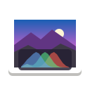
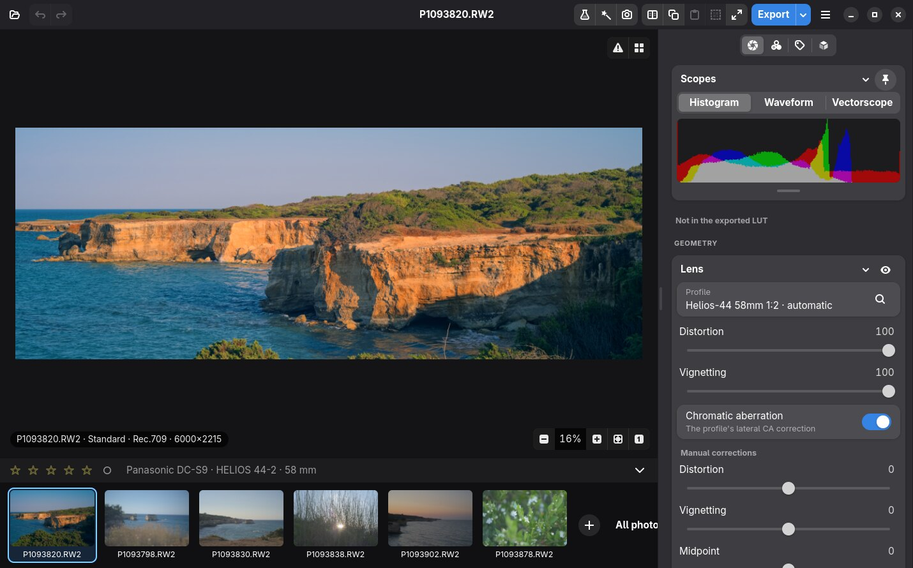
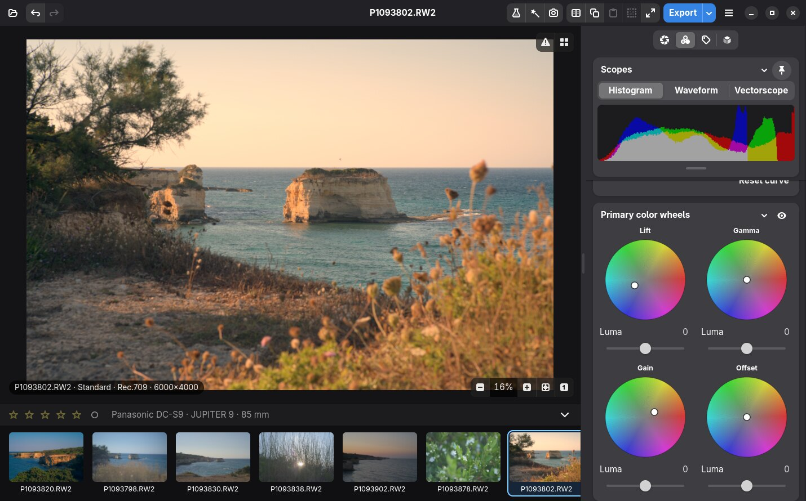
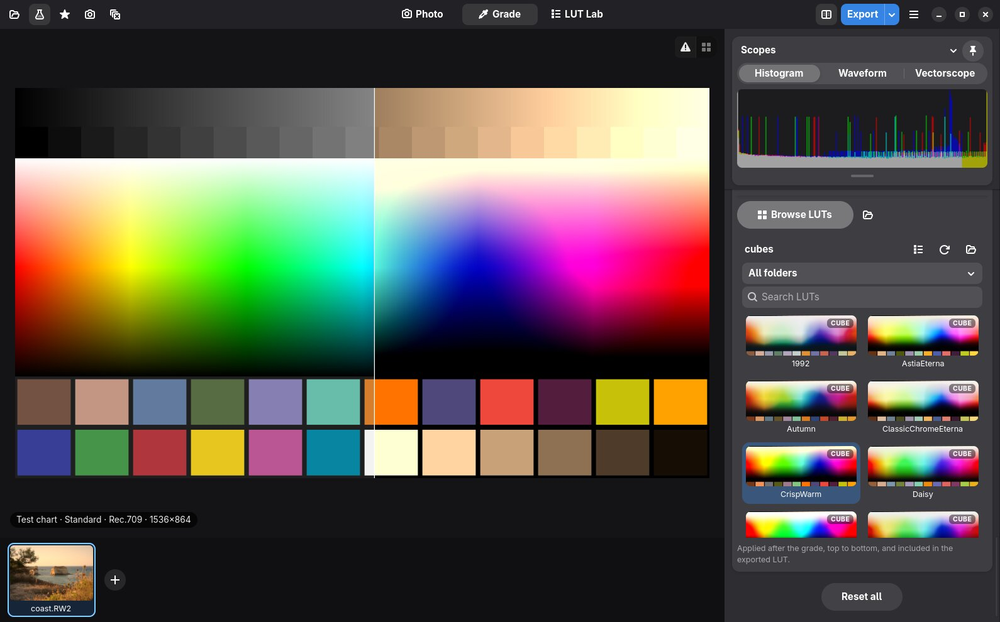
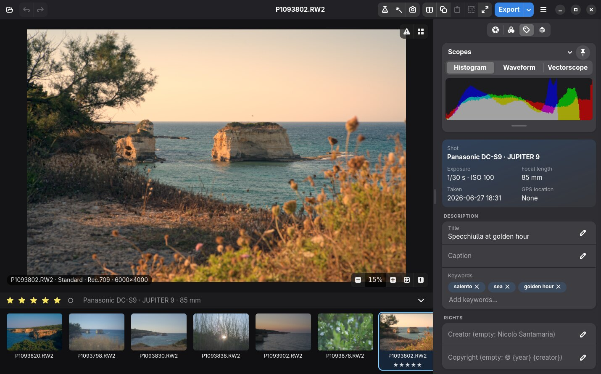
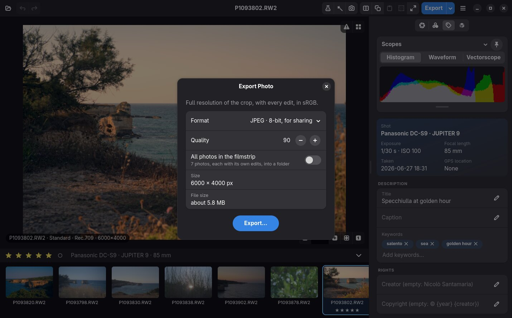

<div align="center">



# RawVibes

### Free RAW photo editor for Linux and macOS that turns your edit into a camera LUT

RawVibes is a free, open-source RAW photo editor with a colorist's grading tools
built in. Develop RAW files from Panasonic, Canon, Nikon, Sony, Fujifilm and most
other cameras on the GPU, grade them with colour wheels, curves and your LUT
library, and export the photo at full resolution. Then export the same grade as a
3D LUT, `.cube` or `.vlt`, and load it on your camera as a Real Time LUT.

[](LICENSE)
[](https://github.com/NicoNex/RawVibes/releases/latest)


**[Download](https://github.com/NicoNex/RawVibes/releases/latest)** ·
[Features](#features) ·
[Install](#install) ·
[Shortcuts](#keyboard-shortcuts) ·
[FAQ](#faq)


</div>

---

## Why RawVibes?

RawVibes started as VibingLUT, a workbench for building and converting 3D LUTs.
Its author shoots a Lumix S9 and wanted one app that goes from the RW2 to the
finished photo, and from the look built on that photo to a LUT loaded into the
camera. RawVibes adds a full RAW development stage in front of the grade.

If you develop with darktable, RawTherapee or Lightroom, RawVibes is an alternative
built around one idea: the look you grade on a photo is also a LUT you can take
with you.

- **One photo, two outputs.** The Photo tab holds what only a still can have:
  noise reduction, sharpening, lens corrections, crop. The Grade tab holds what a
  LUT can carry: tone, colour, curves, LUTs. Export the photo with both, or export
  the Grade alone as a LUT, so the look on the camera matches the look in the app.
- **Published algorithms.** RCD demosaicing, inpaint-opposed highlight
  reconstruction, Richardson–Lucy capture sharpening, lensfun's lens models and the
  RawNIND neural denoiser: ports of the methods darktable and RawTherapee ship.
- **On the GPU from the first pixel.** RAW decoding, demosaicing, development, lens
  corrections, grade and AI denoise run on the GPU through wgpu (Vulkan on Linux,
  Metal on macOS). Sliders draw a fast draft while you drag and the full-quality
  frame when you stop.
- **Your files stay as they are.** Edits are saved as you make them in a small
  sidecar next to the photo (`photo.RW2.rawvibes.json`). Reopen RawVibes and your
  last photos are back where you left them.

---

## Features

### Develop the RAW


The Photo tab follows the order you develop in: light and colour, detail, lens,
geometry.

- **White balance** as shot, from presets (daylight, cloudy, shade, tungsten,
  fluorescent, flash), from a grey you pick on the photo, or by temperature and tint.
- **Exposure** with **inpaint-opposed highlight reconstruction**, so clipped skies
  keep their colour.
- **RCD demosaicing** for Bayer sensors; X-Trans goes through rawler's Markesteijn
  path.
- **Noise reduction, classic or AI.** Classic: non-local means on luminance and
  wavelets on chrominance. AI: the RawNIND UtNet2 network (the weights darktable
  ships), running on the GPU in our own WGSL shaders. A 24 MP RW2 takes about
  2 seconds on an RTX 4070 Ti SUPER.
- **Presence:** dehaze (negative values add haze) and local contrast.
- **Detail:** Richardson–Lucy capture sharpening, and output sharpening with radius
  and threshold.
- **As in camera:** one click sets white balance and exposure as shot. A
  preference applies it to every RAW you open for the first time.

### Lens correction with lensfun profiles



- **Profiles from the [lensfun](https://lensfun.github.io/) database**, found from
  the photo's camera, lens, focal length and aperture. Manual and vintage lenses
  work too: search the lens by name and type in the focal length and aperture.
- The profile corrects **distortion**, **vignetting** and **lateral chromatic
  aberration**, each with its own amount. The maths is a port of lensfun 0.3.4,
  checked against the library.
- **Manual corrections** on top of the profile: distortion, vignetting with
  midpoint, red/cyan and blue/yellow fringes, automatic CA, and purple and green
  defringe.

### Crop and straighten

- **Crop** with ratio presets (1:1, 5:4, 4:3, 3:2, 16:9, 21:9, 2.39:1, XPan 65:24,
  6:17 and their portrait versions). Draw the frame with the mouse, or drag its
  handles; the ratio holds at the edges of the photo.
- **Straighten** by angle or by dragging along the horizon.

### Grade: build the look



- **Warmth and tone:** temperature and tint with CAT16 adaptation; exposure,
  contrast, highlights, shadows, whites and blacks in log space.
- **Colour:** saturation, vibrance, shadow and highlight saturation in OKLab /
  OKLCh, film-style subtractive saturation, and a channel mixer with a black &
  white mode.
- **Primary colour wheels:** lift, gamma, gain and offset, each with a luma control.
- **Selective colour** for eight hue bands, and **hue curves** (hue vs hue, hue vs
  saturation, luminance vs saturation).
- **Curves:** master and R/G/B, monotone (Fritsch–Carlson) so they never overshoot.
- **Soft light** and a **creative vignette** with amount, midpoint, roundness and
  feather.
- **Reference match:** pick a photo whose colour you like and RawVibes fits the
  grade to it. On a RAW, *Camera JPEG* fits the grade to the JPEG the camera
  embedded, so you can start from the camera's own rendering.
- **Presets** save the whole grade; VibingLUT presets import as they are.

Each section has an eye toggle to switch it off for this photo, and `\` splits the
photo into before and after.

### Try every LUT on your photo

Press `B` and every LUT in your folder is rendered on the photo you are editing
(the screenshot at the top), with search (`Ctrl+F`) and a folder filter. Click a LUT to add it after the grade;
stack as many as you want, each with its own intensity.

### Check your work

- **Scopes:** histogram, waveform and vectorscope with a skin tone line (`K`). Pin
  them so they stay in view while you scroll the panel.
- **Clipping overlay** (`C`) for crushed blacks, clipped highlights and colours out
  of gamut.
- **Zoom** to fit or to 100 % (`Ctrl+1`), and pan by dragging.
- **Test chart** (`T`): grey ramps, a full hue sweep and the 24 ColorChecker
  patches, so a LUT that tints neutrals or bends skin tones shows at once.



### Sort and sync a shoot

- **Filmstrip** to move between photos, or a grid of all of them (`G`). Hide it
  when you want the whole window for the photo.
- **Star ratings** (`1`–`5`, `0` clears) and **colour labels** (`6` red, `7`
  yellow, `8` green, `9` blue, or purple from the bar under the photo), saved in
  the photo's sidecar. The filmstrip filter shows only the photos with enough stars
  or a given label.
- **Undo and redo** every edit of a photo (`Ctrl+Z`, `Ctrl+Shift+Z`).
- **Copy and paste edits** between photos (`Ctrl+Shift+C`, `Ctrl+Shift+V`), or
  paste them onto every photo in the filmstrip at once. Each photo keeps its own
  crop, stars, label and metadata.

### Metadata: title, keywords and copyright



The Metadata tab (`Alt+3`) shows what the camera recorded (camera, lens, exposure,
focal length, date, GPS) and lets you write a **title**, **caption**, **keywords**,
**creator**, **copyright** and **location** for each photo.

In Preferences, set your name, email and website once, and a copyright line such as
`© {year} {creator}`. They fill every photo that has none. You also choose how
much metadata an export carries:

| Export metadata | What the file carries |
|---|---|
| All | Everything, GPS and serial numbers included |
| Essential (default) | Camera, lens, exposure, date, your text fields. No GPS, no serial numbers |
| Copyright only | Creator, copyright and contact |
| None | No metadata |

### Export the photo



`Ctrl+E` exports the full resolution of the crop with every edit. The SDR formats are
sRGB with an embedded ICC profile. The HDR formats carry an HDR rendition of the same
look: the highlights a RAW or log photo holds go up to the *HDR headroom* (1–3 stops)
above SDR white, while the grade and LUTs stay as you see them.

| Format | For |
|---|---|
| JPEG, 8-bit | Sharing. Dithered, so skies don't band. |
| JPEG HDR | Phones and browsers. An Ultra HDR JPEG with an ISO 21496-1 gain map: HDR screens show the brighter highlights, every other viewer shows the normal JPEG. |
| JPEG XL HDR | Small HDR files, Rec.2100 PQ (libjxl). Viewers tone-map it for SDR screens. |
| AVIF HDR | HDR on the web, Rec.2100 PQ, 10-bit (libavif with libaom). |
| PNG HDR, 16-bit | Lossless HDR, Rec.2100 PQ (cICP). |
| PNG, 16-bit | Lossless archive. |
| TIFF, 16-bit | Print, or more editing in another app. |

The dialog shows the expected file size as you change the format, quality or headroom
(the gain map included). Every format except TIFF carries EXIF and XMP metadata (title,
keywords, rights), so Lightroom, digiKam and photo sites read them. The file is written to a temporary copy first,
so stopping an export leaves the old file untouched.

**Batch export:** switch on *All photos in the filmstrip* and choose a folder.
Each photo the filmstrip shows (filter included) is exported with its own edits,
as `<name>_edit.jpg`. The suffix is a preference.

### Create a LUT from a photo

Grade the photo, then press `Ctrl+Shift+E` to export the Grade tab, LUTs included,
as a 33³ `.cube`. The export menu has the other sizes and formats:

| Target | Format | Size |
|---|---|---|
| Cameras, monitors, recorders, OBS | `.cube` | 33³ |
| Grading and editing (Resolve, Premiere, Final Cut, Nuke…) | `.cube` | 65³ |
| Maximum precision | `.cube` | 129³ |
| Panasonic VariCam / Lumix (native format) | `.vlt` | 17³ |
| Photo editors, GIMP, ImageMagick, ffmpeg `haldclut` | HALD CLUT `.png` (16-bit) | 64³ |
| Identity HALD for external tools | HALD `.png` | 64³ |

The LUT holds only what a LUT can reproduce. Noise reduction, sharpening, lens
corrections and crop stay in the Photo tab.

### LUT Lab: combine LUTs and convert them between log profiles


- **Chain** LUTs one after another, or **mix** them as a weighted average in OKLab,
  each with its own intensity.
- **Retarget a LUT to another camera profile.** Tell the Lab which profile a LUT
  was made for and which signal you will load it on. The conversion uses the
  manufacturers' log curves and gamut matrices. Use Fujifilm's F-Log2 C film
  simulation LUTs on a Panasonic in V-Log, turn a V-Log to Rec.709 LUT into one
  for S-Log3 or C-Log3, and back.
- The source profile is detected from vendor file names such as
  `FLog2C_to_ETERNA…`, and a plain-language line says what the exported LUT will do.

---

## Supported cameras and profiles

**RAW in:** every format [rawler](https://crates.io/crates/rawler) decodes: Panasonic
RW2 and RAW, Canon CR3, CR2 and CRW, Nikon NEF and NRW, Sony ARW, SR2 and SRF,
Fujifilm RAF (X-Trans too), Olympus / OM System ORF, Pentax PEF, Samsung SRW, Leica
RWL, Hasselblad 3FR and FFF, Phase One IIQ, Sigma X3F, Kodak, Minolta, Mamiya, Leaf,
Epson and ARRI files, and DNG from any camera or phone. Monochrome sensors open too.
The Lumix S9 is tuned and tested first. JPEG, PNG, TIFF and WebP open with the
Grade, LUT and crop tools.

**Log profiles** for grading, LUT export and LUT conversion:

| Maker | Profile |
|---|---|
| Any camera | Standard · Rec.709 (Photo Styles such as Standard, Vivid, Natural…) |
| Panasonic | V-Log |
| Sony | S-Log3 · S-Gamut3.Cine, S-Log3 · S-Gamut3 |
| Canon | C-Log3 |
| Fujifilm | F-Log, F-Log2, F-Log2 C |
| Nikon | N-Log |
| ARRI | LogC3 (EI 800), LogC4 |
| Blackmagic | Film Gen 5 |
| DJI | D-Log |
| RED | Log3G10 |
| Apple | Apple Log |

### Using a LUT on a Lumix (S9, S5 II, GH7…)

Export the **33³ `.cube`** (or **17³ `.vlt`**), copy it to the SD card, and load it
as a *Real Time LUT* from the camera menu. Lumix cameras apply a LUT on top of any
Photo Style, so a look graded on the *Standard* profile works on Standard, Vivid
and the others as well as on V-Log.

---

## How it works

1. **Open a photo:** drag it in, press `Ctrl+O`, or choose *Open With → RawVibes*
   in your file manager.
2. **Develop it** in the Photo tab: white balance, exposure, noise, detail, lens,
   crop.
3. **Grade it** in the Grade tab: tone, colour, curves, LUTs from your library.
   Check the scopes and the before/after split.
4. **Export** the photo with `Ctrl+E`, the look as a LUT with `Ctrl+Shift+E`, or
   both.

---

## Under the hood

- **Linear Rec.2020 pipeline.** The RAW is developed in scene-linear Rec.2020
  through the camera matrix and gamut-compressed only at the output encode. A
  neutral, hue-preserving view transform maps it to the display.
- **Exact LUT bake.** The grade is evaluated directly at every lattice point. The
  GPU preview and the CPU reference are tested against each other, and a 65³ bake
  is checked against the direct grade.
- **Tetrahedral interpolation** wherever a LUT is applied, on the GPU and the CPU.
- **CAT16** white balance, **OKLab / OKLCh** colour work, a C¹-continuous gamut fit
  and **Fritsch–Carlson** monotone curves.
- **Slider audit.** A test sweeps every grade and development slider and every
  curve over its full range on images with a known answer: identity at neutral,
  monotone, no dead zones, balanced around zero, finite output.
- **Separate engine.** `rawvibes-core` has no UI dependency, so another front end
  (a CLI, a plug-in) can reuse it.

```
core/    rawvibes-core: RAW development, colour science, profiles, lens corrections, metadata, LUT I/O, GPU engine (wgpu + WGSL), AI denoise
gtk/     rawvibes: GTK4 / libadwaita desktop app (Relm4)
models/  RawNIND denoise weights (fetched with `make models`)
po/      translations (gettext)
tools/   lensfun database converter, model converter
```

---

## Install

Every push to `master` builds an Arch Linux package and a macOS disk image and
publishes them in the [latest release](https://github.com/NicoNex/RawVibes/releases/latest).
Once installed, RawVibes shows up under *Open With* when you right-click a photo or
a RAW.

### Arch Linux

```sh
make arch                       # builds a package from the committed HEAD
sudo pacman -U packaging/arch/rawvibes-*.pkg.tar.zst
```

### From source (any Linux)

You need Rust (stable), GTK ≥ 4.20, libadwaita ≥ 1.9, gettext and a Vulkan driver.
Lens profiles need the lensfun database (`lensfun` package) at build time.

```sh
make models                     # fetch and convert the AI denoise weights (curl, unzip, python3 + onnx, numpy)
make run FILE=photo.RW2         # debug build, optionally open a photo
make release                    # optimised build
sudo make install               # installs to /usr/local; use PREFIX=~/.local for a user install
```

Other targets: `make test`, `make check` (format, clippy and tests), `make pot`
(refresh translations), `make clean`.

### macOS (Apple silicon)

Open the `.dmg`, drag RawVibes to Applications, and follow its `README.txt`: the
app is not signed with an Apple Developer ID, so you clear the quarantine flag once
with `xattr -cr /Applications/RawVibes.app`. To build the disk image yourself, install
`gtk4 libadwaita adwaita-icon-theme librsvg gettext dylibbundler` with Homebrew and
run `make dmg`.

---

## Keyboard shortcuts

| Action | Shortcut |
|---|---|
| Open photo | `Ctrl+O` |
| Undo / redo | `Ctrl+Z` / `Ctrl+Shift+Z` |
| Copy / paste edits | `Ctrl+Shift+C` / `Ctrl+Shift+V` |
| Stars / colour label | `0`–`5` / `6`–`9` |
| Photo / Grade / Metadata / LUT Lab | `Alt+1` / `Alt+2` / `Alt+3` / `Alt+4` |
| Before / after split | `\` |
| Browse LUTs on the photo / search them | `B` / `Ctrl+F` |
| Edit crop | `R` |
| Zoom to fit / 100 % | `Ctrl+0` / `Ctrl+1` |
| Show clipping | `C` |
| Skin tone line | `K` |
| Grid of all photos | `G` |
| Test chart | `T` |
| Save preset | `Ctrl+S` |
| Export photo | `Ctrl+E` |
| Export LUT (33³ `.cube`) | `Ctrl+Shift+E` |
| Fullscreen | `F11` |
| Preferences | `Ctrl+,` |
| All shortcuts | `Ctrl+?` |

---

## Roadmap

- Perspective correction, guided by lines you draw on the photo.
- HDR output.

## Translations

The interface is in English, with an Italian translation. Translations use
gettext: copy `po/rawvibes.pot` to `po/<language>.po`, translate it, and `make`
picks it up. Pull requests for new languages are welcome.

## FAQ

**Is RawVibes a free alternative to Lightroom on Linux?**
For developing and grading single photos and shoots, yes: RAW development, lens
corrections, colour grading, ratings, metadata and batch export. It has no photo
catalogue or cloud sync; your photos stay in your folders.

**Which cameras does it support?**
Every camera rawler decodes. Development is tuned on the Lumix S9 first; if your
RAW opens with odd colours, please open an issue with a sample file.

**How do I make a LUT from a photo?**
Grade the photo in the Grade tab and press `Ctrl+Shift+E`. You get a 33³ `.cube`
that cameras, monitors, DaVinci Resolve and Premiere load. The export menu has 65³
and 129³ `.cube`, Panasonic `.vlt` and HALD CLUT `.png`.

**Will the exported LUT look like the Grade tab?**
Yes, within the precision of the lattice size you choose. The preview and the
export run the same code, and the LUT leaves out the Photo-tab tools a LUT cannot
reproduce.

**Can I use a Fujifilm film simulation LUT on a Sony or Panasonic?**
Yes. LUT Lab converts a LUT from the log profile it was made for (F-Log2 C, for
example) to the one your camera records (V-Log, S-Log3, C-Log3 and the others in
the table above).

**Does the AI denoise send my photos anywhere?**
No. The model ships with the app and runs on your GPU.

**Does exporting leak my location?**
Not by default. The *Essential* metadata setting leaves out GPS and serial
numbers; only *All* includes them.

**Does it need a powerful GPU?**
Any Vulkan-capable GPU runs the editor. AI denoise is much faster on a discrete
GPU.

**Is it free?**
Yes. RawVibes is free software under the GPL-3.0. The RawNIND weights are
GPL-3.0 / CC-BY-4.0 (see [models/README.md](models/README.md)); the lensfun
database is CC-BY-SA 3.0 (see [LENSFUN.md](LENSFUN.md)).

## License

[GPL-3.0-or-later](LICENSE).
